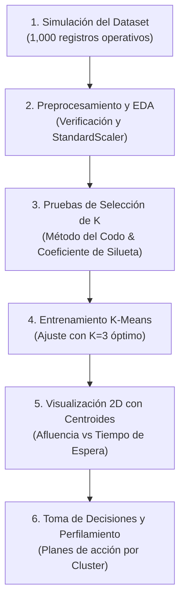

# 🚍 Optimización y Segmentación Operativa de un Sistema de Transporte Masivo
## **Actividad de Aprendizaje No Supervisado - Algoritmo K-Means**
### **Materia:** Inteligencia Artificial / Analítica de Datos

---

## 📌 1. ¿Qué se supone que hacemos en este proyecto? (Contexto del Problema)

En una ciudad con alta densidad poblacional, los **Sistemas de Transporte Masivo** (como Metro, TransMilenio, MIO, Metroplús o Metrobús) enfrentan un gran desafío: **la demanda de pasajeros y la congestión varían drásticamente según la hora del día y la ubicación de las estaciones**.

Si la empresa de transporte opera todas las estaciones y todas las horas con la misma cantidad de buses y personal:
- ❌ **En horas pico:** Las estaciones colapsan, los tiempos de espera superan los 20 minutos, los buses se retrasan y se generan quejas y riesgos de seguridad.
- ❌ **En horas valle:** Los buses circulan casi vacíos, desperdiciando combustible, desgastando la flota e incurriendo en sobrecostos operativos innecesarios.

### 🎯 **¿Cuál es el objetivo?**
Utilizar **Inteligencia Artificial (Aprendizaje No Supervisado - K-Means)** para analizar los datos de operación y **descubrir automáticamente patrones y perfiles de estaciones y franjas horarias** sin necesidad de etiquetas previas, permitiendo a la gerencia de operaciones **tomar decisiones estratégicas basadas en datos**.

---

## 🛠️ 2. Flujo Metodológico del Proyecto (Paso a Paso)



1. **Simulación de Datos Operativos:** Generación de un conjunto de datos realista (`datos_transporte_masivo.csv`) con variables clave del sistema:
   - `afluencia_pasajeros`: Cantidad de usuarios por hora.
   - `tiempo_espera_promedio`: Minutos en plataforma esperando el bus.
   - `retraso_promedio_bus`: Demora en minutos respecto al horario programado.
   - `tarjetas_recargadas`: Volumen de transacciones en taquillas/tótems.
   - `franja_horaria_cod`: Clasificación horaria (1=Valle/Noche, 2=Intermedia, 3=Pico).

2. **Procesamiento y Normalización:**
   - Verificación de valores faltantes (0 nulos).
   - **Escalado con `StandardScaler`:** Imprescindible para algoritmos de distancia como K-Means, ya que evita que valores grandes (como 2,000 pasajeros) dominen sobre valores pequeños (como 5 minutos de retraso).

3. **Determinación Técnica del Número Óptimo de Grupos ($K$):**
   - **Método del Codo:** Evalúa la inercia (suma de cuadrados intra-cluster) entre $K=1$ y $K=10$.
   - **Coeficiente de Silueta:** Evalúa cohesión interna vs. separación externa ($K=2$ a $K=6$). El valor máximo obtenido fue **$K=3$ con una silueta de 0.8042** (calidad excelente).

4. **Entrenamiento y Segmentación Final:**
   - Se ajusta el modelo final con $K=3$ y se añade la columna `cluster` y `perfil_operativo` al dataset.

5. **Visualización y Perfilamiento Estadístico:**
   - Gráfico de dispersión 2D identificando claramente los 3 grupos y sus centroides operativos.

---

## 📊 3. Interpretación de los Clusters y Toma de Decisiones

A partir de los centroides y promedios calculados por el modelo, se obtienen 3 perfiles operacionales claros:

| Cluster | Nombre del Perfil | Métricas Promedio | Decisiones de Negocio / Operación |
| :---: | :--- | :--- | :--- |
| **Cluster 1** <br>🔴 *(Rojo)* | **Estaciones Críticas / Hora Pico** <br>*(25% de la operación)* | • Afluencia: ~1,635 pax/h<br>• Espera: ~19.0 min<br>• Retraso bus: ~13.5 min<br>• Recargas: ~980 | • Inyectar **buses expresos de refuerzo**.<br>• Abrir taquillas auxiliares y recarga digital.<br>• Desplegar reguladores de flujo en plataformas para evitar accidentes. |
| **Cluster 2** <br>🔵 *(Azul)* | **Operación Moderada / Flujo Regular** <br>*(40% de la operación)* | • Afluencia: ~708 pax/h<br>• Espera: ~8.5 min<br>• Retraso bus: ~4.5 min<br>• Recargas: ~380 | • Mantener frecuencias estándar programadas.<br>• Priorizar sincronización semafórica en corredores exclusivos.<br>• Monitoreo preventivo de cumplimiento de itinerario. |
| **Cluster 0** <br>🟢 *(Verde)* | **Operación Valle / Baja Demanda** <br>*(35% de la operación)* | • Afluencia: ~180 pax/h<br>• Espera: ~3.5 min<br>• Retraso bus: ~1.2 min<br>• Recargas: ~90 | • **Reducir flota activa** para ahorrar combustible y mantenimiento.<br>• Programar mantenimientos mayores en talleres.<br>• Reasignar conductores a rutas de mayor impacto. |

---

## 📁 4. Estructura de Archivos del Proyecto

```text
actividad6-integencia-artificial/
│
├── README.md                              # Guía del proyecto y sustentación
├── transporte_masivo_kmeans.py            # Script ejecutable modular en Python
├── transporte_masivo_kmeans.ipynb         # Jupyter Notebook interactivo paso a paso
│
├── datos_transporte_masivo.csv            # Dataset sintético original (1,000 filas)
├── datos_transporte_masivo_clusterizado.csv # Dataset final con clusters asignados
│
├── evaluacion_k_optimo.png                # Gráfica del Método del Codo y Silueta
└── clusters_transporte_masivo.png         # Gráfica de dispersión 2D con centroides
```

---

## 🚀 5. ¿Cómo Ejecutar el Proyecto?

### Opción A: Ejecutar mediante Script de Python
En una terminal con Python y las librerías instaladas:
```bash
python transporte_masivo_kmeans.py
```

### Opción B: Abrir el Jupyter Notebook
Abre Visual Studio Code, Jupyter Lab o Google Colab y ejecuta el archivo:
```bash
jupyter notebook transporte_masivo_kmeans.ipynb
```

### Requisitos / Librerías necesarias:
```bash
pip install numpy pandas matplotlib seaborn scikit-learn
```

---

## 🎥 6. Guión Recomendado para la Sustentación en Video

1. **Introducción (1 min):** Presentar el equipo y el objetivo: aplicar aprendizaje no supervisado (K-Means) para optimizar un sistema de transporte masivo mediante segmentación de demanda.
2. **Dataset y Variables (1 min):** Explicar las 5 variables utilizadas y la necesidad de usar `StandardScaler` debido a la diferencia de escalas.
3. **Selección de K (1.5 min):** Mostrar la gráfica `evaluacion_k_optimo.png`. Explicar el punto de inflexión del codo y por qué el coeficiente de silueta de **0.8042** justifica elegir $K=3$.
4. **Resultados y Centroides (1.5 min):** Mostrar la gráfica `clusters_transporte_masivo.png` explicando los 3 perfiles (Valle, Regular, Crítico).
5. **Conclusiones y Toma de Decisiones (1 min):** Resumir cómo estos clusters permiten inyectar flota donde se necesita y ahorrar costos donde la demanda es baja.
